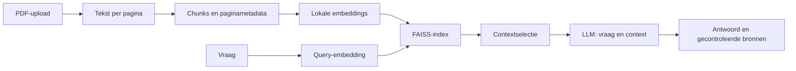
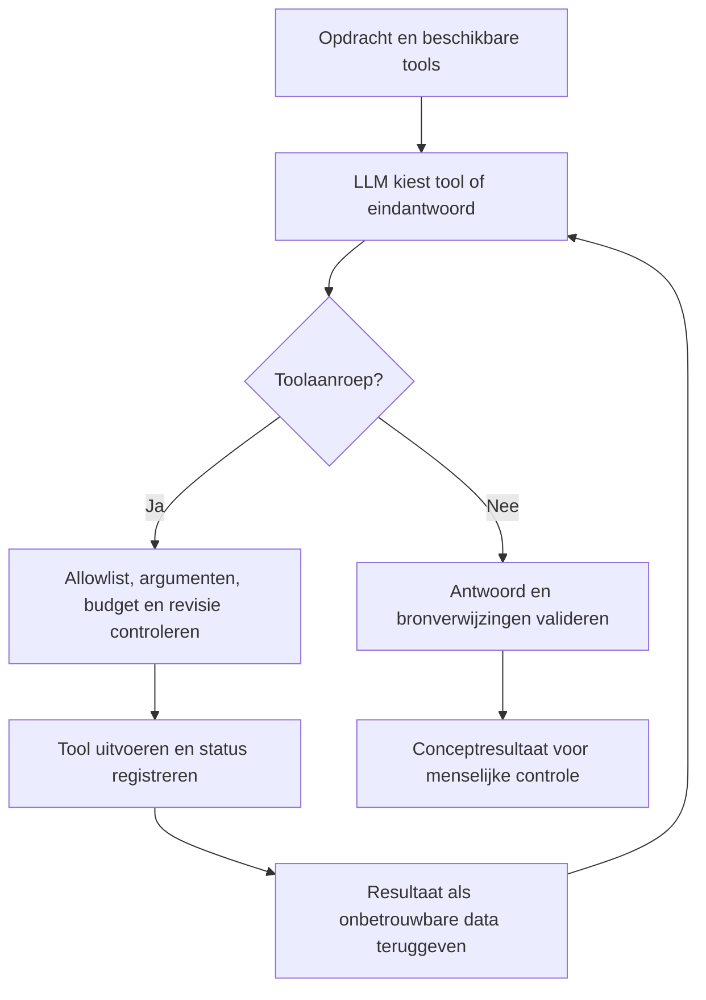

# Folio

**Document Chat en AI-agents voor documentanalyse en fictieve bedrijfsprocessen.**

Folio maakt PDF-documenten doorzoekbaar met Retrieval-Augmented Generation (RAG). Stel vragen met bronverwijzingen, vergelijk documentversies, onderzoek retourverzoeken, controleer testfacturen of maak een conceptantwoord op een klantvraag.

De applicatie combineert een React/TypeScript-frontend met een FastAPI-backend. Embeddings en vector search draaien lokaal; antwoordgeneratie en toolselectie verlopen via een LLM-API. De huidige provideradapter gebruikt Google Gemini. Agentresultaten zijn concepten voor menselijke beoordeling: Folio wijzigt geen bestellingen, verstuurt geen berichten en voert geen betalingen uit.

## Inhoud

- [Functionaliteiten](#functionaliteiten)
- [Installatie en starten](#installatie-en-starten)
- [Gebruik en voorbeelden](#gebruik-en-voorbeelden)
- [Architectuur](#architectuur)
- [RAG-pipeline](#rag-pipeline)
- [Agents en tool calling](#agents-en-tool-calling)
- [Configuratie](#configuratie)
- [API](#api)
- [Gegevensverwerking en veiligheidsgrenzen](#gegevensverwerking-en-veiligheidsgrenzen)
- [Tests en build](#tests-en-build)
- [Problemen oplossen](#problemen-oplossen)
- [Bekende beperkingen](#bekende-beperkingen)

## Functionaliteiten

| Onderdeel                      | Functie                                                                                                                                 |
| ------------------------------ | --------------------------------------------------------------------------------------------------------------------------------------- |
| **Document Chat**              | Beantwoordt vragen over één PDF met geciteerde fragmenten en links naar bronpagina's.                                                   |
| **Documentvergelijking agent** | Vergelijkt twee PDF's en rapporteert gewijzigde, toegevoegde, verwijderde, ongewijzigde en onzekere voorwaarden.                        |
| **Retourbeoordeling agent**    | Onderzoekt een fictief retourverzoek met beleidsdocumenten, lokale bestelgegevens en datumberekeningen.                                 |
| **Factuurverwerking agent**    | Extraheert testfacturen, controleert bedragen met Python en vergelijkt fictieve inkooporders. Ondersteunt lokale review en JSON-export. |
| **Klantenservice agent**       | Analyseert een fictieve klantvraag, stelt categorie, prioriteit en escalatie voor en maakt een bewerkbaar conceptantwoord.              |

Uploads worden gecontroleerd op bestandstype, grootte en uitleesbare tekst. De interface toont laadstatussen, foutmeldingen en ontbrekende informatie. Agentconclusies staan bovenaan het resultaat; bronnen, tools en factuurcontroles zijn in- en uitklapbaar.

De hoofdnavigatie bevat **Document Chat** en **AI Agents**. De agentbibliotheek groepeert de agents als volgt:

| Categorie                   | Agents                                        |
| --------------------------- | --------------------------------------------- |
| Algemeen & productiviteit   | Documentvergelijking agent                    |
| E-commerce & klantenservice | Retourbeoordeling agent, Klantenservice agent |
| Financiën & administratie   | Factuurverwerking agent                       |

## Installatie en starten

### Vereisten

- Python **3.11 of hoger**.
- Node.js **22.12 of hoger** en npm.
- Een API-sleutel met toegang tot het ingestelde LLM-model.
- Internet voor de eerste embeddingmodeldownload en voor LLM-aanroepen.

Lokale embeddings draaien op de CPU; een GPU is niet nodig. De Python-installatie bevat ook PyTorch. De eerste modeldownload en het laden van gewichten kosten extra tijd, schijfruimte en werkgeheugen.

Voer de opdrachten uit vanuit de projecthoofdmap, tenzij anders aangegeven.

### 1. Backend installeren

**Windows PowerShell**

```powershell
python -m venv .venv
.\.venv\Scripts\python.exe -m pip install -e "./backend[dev]"
if (!(Test-Path .env)) { Copy-Item .env.example .env }
```

**macOS / Linux**

```bash
python3 -m venv .venv
source .venv/bin/activate
python -m pip install -e './backend[dev]'
[ -f .env ] || cp .env.example .env
```

De extra dependencies uit `[dev]` bevatten onder andere pytest en Ruff. Een bestaande `.env` wordt behouden.

### 2. LLM configureren

Vul in `.env` in de hoofdmap de backendinstellingen in:

```dotenv
GEMINI_API_KEY=plaats_hier_je_eigen_sleutel
GEMINI_MODEL=gemini-3.5-flash-lite
EMBEDDING_MODEL=intfloat/multilingual-e5-small
```

`gemini-3.5-flash-lite` is de standaardmodelnaam in de huidige code en `.env.example`. Controleer of dit model beschikbaar is voor het eigen providerproject; een configuratiewaarde garandeert geen toegang of gratis gebruik.

Maak een sleutel aan in [Google AI Studio](https://aistudio.google.com/apikey). De sleutel blijft uitsluitend in de backend. Gratis gebruik is afhankelijk van quota, modeltoegang en voorwaarden die kunnen wijzigen. Folio controleert niet of een sleutel bij een gratis of betaald project hoort. Raadpleeg de provider voor [modellen](https://ai.google.dev/gemini-api/docs/models), [tarieven](https://ai.google.dev/gemini-api/docs/pricing) en [quota](https://ai.google.dev/gemini-api/docs/rate-limits).

### 3. Backend starten

**Windows PowerShell — terminal 1**

```powershell
.\.venv\Scripts\python.exe -m uvicorn app.main:app --app-dir backend --host 127.0.0.1 --port 8000 --reload
```

**macOS / Linux — terminal 1, met geactiveerde virtuele omgeving**

```bash
python -m uvicorn app.main:app --app-dir backend --host 127.0.0.1 --port 8000 --reload
```

- Healthcheck: <http://127.0.0.1:8000/api/health>
- API-documentatie: <http://127.0.0.1:8000/docs>

Stop met `Ctrl+C` en start opnieuw met hetzelfde commando. Herstart na wijzigingen in `.env`. Een backendherstart wist documenten en indexen in het geheugen; upload PDF's daarna opnieuw. Gebruik één backendproces, zonder meerdere workers.

### 4. Frontend starten

**Terminal 2**

```bash
cd frontend
npm ci
npm run dev
```

Open <http://127.0.0.1:5173>. Het devscript vereist dat poort 5173 vrij is.

Het standaard API-adres is `http://127.0.0.1:8000`. Kopieer voor een ander adres `frontend/.env.example` naar `frontend/.env`, wijzig `VITE_API_BASE_URL` en herstart Vite. Alle `VITE_`-variabelen zijn openbaar in de browserbundle: plaats hier nooit een API-sleutel.

### Optioneel: embeddingmodel vooraf downloaden

De eerste upload downloadt en laadt het model automatisch. Vooraf downloaden en lokale inferentie controleren kan ook:

```powershell
.\.venv\Scripts\python.exe backend/scripts/download_embeddings.py
```

Dit script roept de LLM niet aan. Na een geslaagde download kan `EMBEDDING_LOCAL_FILES_ONLY=true` worden ingesteld om alleen de cache te gebruiken. Antwoordgeneratie blijft internet vereisen.

## Gebruik en voorbeelden

### Document Chat

1. Upload een PDF met selecteerbare tekst via bestandskeuze of slepen.
2. Wacht tot bestandsnaam, pagina-aantal en aantal tekstfragmenten zichtbaar zijn.
3. Stel een zelfstandige vraag. `Enter` verstuurt; `Shift+Enter` maakt een nieuwe regel.
4. Bekijk de bronfragmenten en controleer de oorspronkelijke PDF via de paginalinks.

Vragen mogen maximaal 2.000 tekens bevatten. Eerdere berichten blijven zichtbaar, maar worden niet als gesprekscontext meegestuurd. Bij onvoldoende bewijs volgt een melding in plaats van een inhoudelijk antwoord.

Genereer een fictief projectplan:

```powershell
.\.venv\Scripts\python.exe backend/scripts/create_example.py
```

Upload `examples/groenfiets.pdf` en probeer:

- `Wanneer begint GroenFiets en hoeveel fietsen zijn beschikbaar?`
- `Hoe is het budget verdeeld?`
- `Wie is de projectleider?`
- `Wat was de omzet in 2025?` — deze informatie ontbreekt; een melding over onvoldoende context is het verwachte gedrag.

### Documentvergelijking agent

Open de agent onder **Algemeen & productiviteit**. Upload de oude versie als **Document A** en de nieuwe versie als **Document B**. Kies een gerichte of bredere vergelijking en beschrijf welke voorwaarden relevant zijn.

```powershell
.\.venv\Scripts\python.exe backend/scripts/create_comparison_examples.py
```

Dit genereert `examples/refund_policy_2025.pdf` en `examples/refund_policy_2026.pdf`. Voorbeeldopdracht: `Vergelijk de retourtermijn, verzendkosten en uitzonderingen. Benoem ook ongewijzigde voorwaarden.`

Bevindingen tonen de oude en nieuwe situatie, het wijzigingstype en bronnen uit beide documenten. Onvoldoende bewijs leidt tot onzekerheid. Het dekkingsoverzicht toont opgehaalde passages en pagina's, zonder volledige inhoudelijke vergelijking te garanderen.

### Retourbeoordeling agent

Genereer het fictieve retourbeleid:

```powershell
.\.venv\Scripts\python.exe backend/scripts/create_refund_policy.py
```

Upload `examples/refund_policy.pdf` en open de agent onder **E-commerce & klantenservice**. Gebruik bijvoorbeeld `DEMO-1001` met: `Onderzoek het retourverzoek; controleer de termijn en uitzonderingen.` De fixture bevat ook `DEMO-1002` en `DEMO-1003`.

Een order-ID is optioneel. Bij `Wat is de retourtermijn volgens dit document?` kan alleen documentsearch nodig zijn. Een concreet retourverzoek kan daarnaast bestelgegevens en datumberekeningen vereisen. De LLM kiest welke tools worden aangevraagd. Het resultaat blijft conceptadvies, zonder terugbetalingsbesluit.

### Factuurverwerking agent

Genereer de testfacturen:

```powershell
.\.venv\Scripts\python.exe backend/scripts/create_invoice_examples.py
```

Open de agent onder **Financiën & administratie** en upload een bestand uit `examples/invoices/`.

| Bestand                        | Testscenario                                                              |
| ------------------------------ | ------------------------------------------------------------------------- |
| `invoice_correct.pdf`          | Intern correcte bedragen en passende fictieve inkooporder.                |
| `invoice_wrong_total.pdf`      | Vermeld totaal van 409,30 EUR, terwijl 399,30 EUR wordt verwacht.         |
| `invoice_price_difference.pdf` | Intern correcte berekening, maar een eenheidsprijs die afwijkt van de PO. |
| `invoice_unknown_po.pdf`       | Verwijst naar een onbekende inkooporder.                                  |
| `invoice_missing_data.pdf`     | Velden ontbreken en moeten `null` blijven.                                |

Gebruik de standaardopdracht voor extractie, rekencontrole en PO-vergelijking. Bekijk de conclusie, gegevens, bronnen en controles. Markeer het resultaat eventueel lokaal als beoordeeld en exporteer het naar JSON. De export bevat de serverresponse, exacte decimale strings en de aparte reviewmarkering. Financiële goedkeuring en uitgevoerde betaling blijven `false`.

Alleen facturen met het label `FICTIEVE TESTFACTUUR` worden geaccepteerd. Dat label is een demobeperking, geen anonimisering. De bedoelde uitkomsten veronderstellen een juiste extractie; live modeloutput kan variëren. Meer informatie staat bij [de factuurvoorbeelden](examples/invoices/README.md).

### Klantenservice agent

Genereer de voorbeeldkennisbank:

```powershell
.\.venv\Scripts\python.exe backend/scripts/create_support_examples.py
```

Open de agent onder **E-commerce & klantenservice**. Een PDF is optioneel voor catalogus- of richtlijnvragen. Upload voor beleidsvragen `examples/support/support_knowledge_base.pdf`, waarin meerdere beleidsgebieden zijn gecombineerd.

Voorbeelden:

- `Ondersteunt product LAP-204 een tweede externe monitor?`
- `Mijn bestelling ORD-1023 is nog niet aangekomen.`
- `Mag ik een geopend product nog retourneren?`
- `Dit is de derde keer dat ik contact opneem en mijn probleem is nog niet opgelost.`

Optionele order- en productvelden bakenen de aanvraag af. Beschikbaar zijn supportorders `ORD-1023` t/m `ORD-1025`, retourorders `DEMO-1001` t/m `DEMO-1003` en producten `LAP-204` en `DOCK-110`. Dit zijn fictieve snapshots, geen actuele bedrijfsgegevens.

Het resultaat bevat een samenvatting, klantintentie, categorievoorstel, prioriteit, ontbrekende informatie, vervolgstap, escalatievoorstel en conceptantwoord. Categorie, prioriteit, escalatie en antwoord zijn lokaal aanpasbaar. Kopiëren vereist een menselijke reviewmarkering; een volgende bewerking maakt die markering ongedaan. Er wordt geen bericht verstuurd of ticket opgeslagen.

Zie [de supportvoorbeelden](examples/support/README.md) en [tickets.json](examples/support/tickets.json) voor meer scenario's. Alle voorbeeldgeneratoren werken ook met `python` wanneer de virtuele omgeving actief is. Gegenereerde PDF's worden door Git genegeerd.

### Documenten vervangen en navigeren

Document Chat, retourbeoordeling, factuurverwerking en de supportkennisbank delen **één actieve PDF**. Een nieuwe upload vervangt dat document en wist de bijbehorende resultaten. Documentvergelijking gebruikt een **onafhankelijk paar**. Beide bestanden moeten succesvol zijn verwerkt voordat het nieuwe paar beschikbaar is. Ook een mislukte vervangingsupload maakt de vorige documentselectie ongeldig.

Navigeren bewaart invoer en resultaten binnen het huidige browservenster. Terug en vooruit werken via hashadressen, zoals `#/chat`, `#/agents` en `#/agents/invoice-processing`. Verversen herstelt geen eerdere frontendstatus. Late antwoorden van vervangen documenten worden genegeerd.

## Architectuur

### Technologieën

| Laag            | Implementatie                                                                |
| --------------- | ---------------------------------------------------------------------------- |
| Frontend        | React 19, TypeScript en Vite.                                                |
| Backend         | Python, FastAPI, Pydantic en pydantic-settings.                              |
| PDF en chunking | PyMuPDF en een eigen functie voor overlappende tekstfragmenten.              |
| Embeddings      | sentence-transformers op de CPU; standaard `intfloat/multilingual-e5-small`. |
| Vector search   | FAISS `IndexFlatIP` met genormaliseerde vectoren voor cosinussimilariteit.   |
| LLM             | Officiële `google-genai` Python-SDK voor JSON-output en function calling.    |
| Tests           | pytest, HTTP-mocks, Vitest, React Testing Library en jsdom.                  |

Er is geen database, authenticatie, LangChain, LlamaIndex of multi-agentorkestratie. Iedere gespecialiseerde agent draait afzonderlijk en hergebruikt dezelfde basisdiensten.

### Mappenstructuur

```text
backend/
  pyproject.toml           # Dependencies en ontwikkeltools
  app/
    main.py               # FastAPI-routes en CORS
    config.py             # Environmentconfiguratie
    schemas.py            # Document Chat-contracten en gedeelde responses
    pdf.py                # PDF-validatie en extractie
    chunking.py           # Paginagebonden tekstfragmenten
    embeddings.py         # Embedder-interface en lokale modeladapter
    retrieval.py          # FAISS-index en vectorzoekfunctie
    chat_retrieval.py     # Extra contextselectie voor Document Chat
    service.py            # Documentopslag en RAG-service
    llm.py                # Antwoordinterface, schema en systeemprompt
    gemini.py             # LLM-provideradapter
    agent_loop.py         # Gedeelde tool-calling-loop
    agent*.py             # Retourbeoordeling, schema's en tools
    comparison*.py        # Vergelijking en documentpaaropslag
    invoice*.py           # Extractie, bewijs en controles
    support*.py           # Ticketanalyse, schema's en tools
    fixtures/             # Fictieve JSON-gegevens
  scripts/                # Modeldownload en voorbeeldgeneratoren
  tests/                  # Backendtests
frontend/
  src/
    App.tsx               # Werkinterfaces en gedeelde status
    agents.ts             # Agent- en categorieconfiguratie
    navigation.ts         # Navigatie via hashadressen
    api.ts                # Backendrequests en foutafhandeling
    types.ts              # TypeScript API-types
    use*.ts               # Statusbeheer en late responses
    components/           # Interfacecomponenten
    *.test.ts(x)          # Frontendtests
examples/                 # Voorbeelden en testscenario's
.env.example              # Backendconfiguratie zonder secrets
```

Services krijgen hun model- en embeddingadapters via interfaces. Een andere LLM-provider vereist een passende adapter en koppeling in `create_app`; alleen een environmentvariabele veranderen schakelt niet van provider. De agentinterface gebruikt momenteel ook SDK-specifieke berichttypen, waarmee een vervangende adapter rekening moet houden.

## RAG-pipeline

RAG haalt documentinformatie op vóór het taalmodel antwoordt. Het model wordt niet getraind op de PDF.



1. **Extractie:** PyMuPDF haalt tekst per fysieke PDF-pagina op. Lege, beschadigde, beveiligde of tekstloze documenten krijgen een foutmelding. Er is geen OCR.
2. **Chunking:** tekst wordt per pagina verdeeld in vensters van standaard 1.200 tekens met 200 tekens overlap. Chunks behouden een ID zoals `p2-c0` en het oorspronkelijke paginanummer. Overlap loopt niet door naar een volgende pagina.
3. **Embeddings:** het meertalige E5-model zet tekst lokaal om in vectoren. Documenten krijgen de prefix `passage: ` en vragen `query: `, ook bij Nederlandse tekst. Indexeren en zoeken gebruiken dezelfde modelinstantie en configuratie.
4. **Vector search:** FAISS vergelijkt genormaliseerde vectoren met een exacte inner-productindex. De score is dan cosinussimilariteit, geen kans op een correct antwoord. De gedeelde zoekfunctie gebruikt `TOP_K` en `MIN_SIMILARITY`.
5. **Chatcontext:** Document Chat combineert vectorrangschikking en BM25 via Reciprocal Rank Fusion. Naburige chunks op dezelfde pagina kunnen worden toegevoegd. Een korte PDF kan bij een samenvattingsvraag volledig worden meegegeven. Het budget voor chunktekst is 24.000 tekens. `TOP_K` begrenst hier de ankerselectie, niet noodzakelijk het uiteindelijke aantal chunks. Agentsearch gebruikt de gedeelde vectorzoekfunctie zonder deze chatuitbreiding.
6. **Generatie:** de LLM ontvangt de vraag en context met chunk-ID's. Het antwoord moet voldoen aan een Pydantic-schema met tekst, geciteerde IDs en een indicatie of de context voldoende is. Alleen daadwerkelijk opgehaalde bron-ID's worden geaccepteerd en gekoppeld aan echte tekst en paginametadata.

Bij onvoldoende context volgt `insufficient_context=true`, met uitleg en zonder bronnen. Anders toont de frontend geciteerde fragmenten en PDF-links. De viewer bepaalt of een link direct naar de fysieke pagina springt. Bronvalidatie controleert herkomst, maar bewijst niet automatisch de juistheid van iedere conclusie.

## Agents en tool calling

Document Chat gebruikt een vaste RAG-route. Een agent laat het model kiezen welke beschikbare tools nodig zijn. Python valideert en voert die tools uit; de SDK doet geen automatische tooldispatch.



### Tools

| Agent                | Beschikbare tools                                                                                     |
| -------------------- | ----------------------------------------------------------------------------------------------------- |
| Retourbeoordeling    | `search_policy`, `get_order_details`, `calculate_days_between`                                        |
| Documentvergelijking | `list_document_sections`, `search_document`, `get_document_passage`                                   |
| Factuurverwerking    | `extract_invoice_data`, `get_purchase_order`, `validate_invoice_totals`, `compare_invoice_with_order` |
| Klantenservice       | `search_knowledge_base`, `get_order_details`, `get_product_information`, `get_support_guidelines`     |

Toolnamen en argumenten zijn per agent afgebakend. Een gelijke naam geeft geen toegang tot andere agenttools. Er is geen vaste keten die bij iedere opdracht alle tools aanroept.

- **Retourbeoordeling** hergebruikt FAISS voor beleid, leest fictieve orders en berekent kalenderdagen met `datetime`. Een succesvol conceptadvies vereist beleidsbronnen.
- **Documentvergelijking** beperkt tools tot het geselecteerde paar. Definitieve wijzigingslabels vereisen voldoende bewijs uit beide versies; ontbrekend bewijs leidt tot onzekerheid. Een zoekopdracht zonder resultaat bewijst niet dat een bepaling ontbreekt.
- **Factuurverwerking** gebruikt de volledige paginatekst binnen de limiet voor een afzonderlijke gestructureerde extractieaanroep. Letterlijke quotes onderbouwen de velden; niet-onderbouwde waarden worden `null`. De extractie wordt per aanvraag gecachet. Python `Decimal` controleert bedragen en vergelijkt de bijbehorende fictieve PO. Het model kan geen herschreven bedragen aan de controletools doorgeven. De backend bepaalt de reviewstatus.
- **Klantenservice** beperkt order- en product-ID's tot toegestane invoer of gecontroleerde gegevens. Alleen opgehaalde bronnen mogen worden geciteerd. Een voorstel wordt uitsluitend aan een geconfigureerde prioriteits- of escalatieregel toegeschreven wanneer die regel is opgehaald en toepasbaar is; andere voorstellen blijven modelvoorstellen.

### Limieten en uitvoeringsstatus

| Agent                | Standaard maximum toolpogingen | Totale deadline |
| -------------------- | ------------------------------ | --------------- |
| Retourbeoordeling    | 5, vast in code                | 90 seconden     |
| Documentvergelijking | 12                             | 120 seconden    |
| Factuurverwerking    | 7                              | 120 seconden    |
| Klantenservice       | 6                              | 90 seconden     |

Ongeldige en geblokkeerde pogingen tellen mee; meerdere calls in één bericht tellen afzonderlijk. Na het budget wordt toolgebruik uitgeschakeld voor een eventuele slotbeurt. Een verdere toolpoging wordt geblokkeerd. Deadlines worden vóór en na model- en toolstappen gecontroleerd; een lopende lokale embeddingbewerking wordt niet geforceerd afgebroken.

Toolstatussen zijn `success`, `not_found`, `error` en `blocked`. Een geslaagde tool kan een afwijking vinden: `success` betekent niet dat een factuurcontrole is goedgekeurd. De backend logt bekende toolnamen en statussen, zonder argumenten, PDF-tekst, sleutels of ruwe providerfouten. Budgetten zijn geen financieel kostenplafond; factuurextractie bevat bovendien een afzonderlijke LLM-aanroep.

## Configuratie

De backend leest `.env` in de projecthoofdmap. Bestaande environmentvariabelen hebben voorrang. [`.env.example`](.env.example) bevat alle instellingen; [`config.py`](backend/app/config.py) bepaalt defaults en validatiegrenzen.

| Variabele                                                  | Standaard                                           | Betekenis                                                            |
| ---------------------------------------------------------- | --------------------------------------------------- | -------------------------------------------------------------------- |
| `GEMINI_API_KEY`                                           | Leeg                                                | Geheime backend-API-sleutel.                                         |
| `GEMINI_MODEL`                                             | `gemini-3.5-flash-lite`                             | Model voor generatie, toolselectie en extractie.                     |
| `GEMINI_TIMEOUT_SECONDS`                                   | `45`                                                | Timeout per providerrequest, in seconden.                            |
| `EMBEDDING_MODEL`                                          | `intfloat/multilingual-e5-small`                    | Lokaal meertalig embeddingmodel.                                     |
| `EMBEDDING_CACHE_DIR`                                      | `.model_cache`                                      | Cache; relatieve paden worden vanaf de hoofdmap opgelost.            |
| `EMBEDDING_LOCAL_FILES_ONLY`                               | `false`                                             | Alleen gecachete modelbestanden gebruiken.                           |
| `EMBEDDING_DOCUMENT_PREFIX` / `EMBEDDING_QUERY_PREFIX`     | `"passage: "` / `"query: "`                         | Prefixes inclusief afsluitende spatie.                               |
| `CHUNK_SIZE` / `CHUNK_OVERLAP`                             | `1200` / `200`                                      | Grootte en overlap in tekens; overlap moet kleiner zijn dan grootte. |
| `TOP_K` / `MIN_SIMILARITY`                                 | `4` / `0.2`                                         | Zoekinstellingen; chat gebruikt extra contextselectie.               |
| `MAX_UPLOAD_MB` / `MAX_PAGES`                              | `10` / `200`                                        | Limieten per PDF: grootte in MiB en fysieke pagina's.                |
| `MAX_EXTRACTED_CHARS` / `MAX_CHUNKS`                       | `1000000` / `2000`                                  | Verwerkingslimieten vóór indexering.                                 |
| `AGENT_TIMEOUT_SECONDS`                                    | `90`                                                | Deadline retourbeoordeling.                                          |
| `COMPARISON_MAX_TOOL_CALLS` / `COMPARISON_TIMEOUT_SECONDS` | `12` / `120`                                        | Toolbudget en deadline vergelijking.                                 |
| `COMPARISON_MAX_CONTEXT_CHARS`                             | `60000`                                             | Cumulatief contextbudget vergelijking.                               |
| `INVOICE_MAX_TOOL_CALLS` / `INVOICE_TIMEOUT_SECONDS`       | `7` / `120`                                         | Toolbudget en deadline factuuronderzoek.                             |
| `INVOICE_MAX_DOCUMENT_CHARS`                               | `24000`                                             | Maximale factuurtekst; langere invoer wordt afgewezen.               |
| `INVOICE_MAX_OUTPUT_TOKENS`                                | `4096`                                              | Outputlimiet factuurmodelbeurten en extractie.                       |
| `SUPPORT_MAX_TOOL_CALLS` / `SUPPORT_TIMEOUT_SECONDS`       | `6` / `90`                                          | Toolbudget en deadline klantenservice.                               |
| `CORS_ORIGINS`                                             | `["http://localhost:5173","http://127.0.0.1:5173"]` | Toegestane browserorigins als JSON-array.                            |
| `VITE_API_BASE_URL`                                        | `http://127.0.0.1:8000`                             | Publieke API-URL, uitsluitend in `frontend/.env`.                    |

Bij een ander embeddingmodel moeten de prefixes bij dat model passen. Herstart de backend en upload opnieuw na model- of chunkwijzigingen. FAISS-indexen worden niet op schijf bewaard of ingelezen, zodat oude vectoren niet met nieuwe modelconfiguraties worden gecombineerd.

## API

De volledige schema's staan in de interactieve [API-documentatie](http://127.0.0.1:8000/docs). Pydantic valideert backendcontracten; overeenkomstige frontendtypes staan handmatig in [`types.ts`](frontend/src/types.ts).

| Methode | Endpoint                     | Invoer en resultaat                                                                                                    |
| ------- | ---------------------------- | ---------------------------------------------------------------------------------------------------------------------- |
| `GET`   | `/api/health`                | Status, aanwezigheid van een ingestelde sleutel en upload-/vraaglimieten.                                              |
| `POST`  | `/api/documents`             | Multipartveld `file`; geeft `201` met document-ID en uploadmetadata.                                                   |
| `POST`  | `/api/questions`             | `document_id`, `question`; geeft `answer`, `sources`, `insufficient_context`.                                          |
| `POST`  | `/api/agent`                 | `document_id`, `instruction`, optioneel `order_id`; geeft conceptadvies, bronnen, tools, status en fout.               |
| `POST`  | `/api/comparisons/documents` | Multipartvelden `document_a`, `document_b`; geeft `201` met vergelijkings-ID en documentmetadata.                      |
| `POST`  | `/api/comparisons`           | Vergelijkings-ID, beide document-ID's, `instruction`, `scope` (`focused` of `broad`); geeft rapport, dekking en tools. |
| `POST`  | `/api/invoices/analyze`      | `document_id`, `instruction`; geeft extractie, controles, afwijkingen, bronnen en reviewstatus.                        |
| `POST`  | `/api/support/analyze`       | `customer_message`, optioneel `document_id`, `order_id`, `product_id`; geeft analyse, referenties, tools en status.    |

Voorbeeld van een chatrequest met de document-ID uit de uploadresponse:

```json
{
  "document_id": "e78160e1-35b9-4776-a2db-a52ce7cf2319",
  "question": "Welke voorwaarden gelden voor thuiswerken?"
}
```

Chatbronnen bevatten `chunk_id`, `page`, `text` en `score`. Agentbronnen kunnen extra documentmetadata bevatten. Klantenservice geeft referenties naar demogegevens afzonderlijk terug.

Ongeldige requests geven HTTP `422`. Upload- en chatfouten gebruiken passende HTTP-statuscodes en `{"error":{"code":"...","message":"..."}}`. Een geldige agentaanvraag kan HTTP `200` geven met een foutstatus en een gevuld `error`-veld, zodat eerdere tools zichtbaar blijven. Controleer dus ook de inhoudelijke status; bij facturen is dat `review_status`.

### CORS

Frontend en backend draaien op verschillende origins. CORS staat browserrequests alleen toe voor de ingestelde combinatie van protocol, hostnaam en poort. Pas bij een ander frontendadres `CORS_ORIGINS` aan en herstart de backend. CORS is geen authenticatie of toegangsbeveiliging voor de API.

## Gegevensverwerking en veiligheidsgrenzen

- **Opslag:** documenttekst en indexen blijven in het geheugen van één backendproces. Alle browservensters delen die opslag; er zijn geen gebruikerssessies. Een herstart wist de documenten. Modelgewichten blijven gecachet.
- **Externe verwerking:** de LLM ontvangt de vraag/opdracht en PDF-fragmenten of toolresultaten. Bij factuurextractie wordt de volledige tekst binnen de limiet verstuurd. Lokale embeddings betekenen niet dat alles offline blijft.
- **Tijdelijke gegevens:** uploadverwerking kan tijdelijk bufferen. De browser gebruikt een `blob:`-URL voor PDF-bronlinks. De interface kan lettertypen via Google Fonts laden.
- **Onbetrouwbare inhoud:** PDF-tekst en toolresultaten zijn data, geen systeeminstructies. Prompts instrueren het model om ingebedde opdrachten te negeren. Allowlists, schema's, documentgebonden bronnen en het ontbreken van schrijftools begrenzen uitvoerbare handelingen.
- **Documentrevisies:** UUID-controles voorkomen dat late uploads of responses bij vervangen documenten worden gebruikt. Een geannuleerd browserverzoek stopt een lopende providerrequest niet gegarandeerd.
- **Menselijke controle:** reviews blijven lokaal en zijn geen opgeslagen audittrail of financiële goedkeuring. Gebruik uitsluitend fictieve gegevens voor de meegeleverde bedrijfsprocessen.
- **Git:** `.env`, modelcache, gegenereerde voorbeeld-PDF's, indexbestanden en buildoutput zijn uitgesloten via `.gitignore`.

Deze maatregelen garanderen geen volledige bescherming tegen promptinjectie of modelfouten. Controleer bronnen en houd rekening met de voorwaarden van de externe provider.

## Tests en build

**Backend — vanuit de hoofdmap, Windows PowerShell**

```powershell
.\.venv\Scripts\python.exe -m pytest backend/tests -q
```

Met een geactiveerde omgeving op macOS/Linux: `python -m pytest backend/tests -q`.

**Frontend — vanuit `frontend/`**

```bash
npm test
npm run build
```

De build voert TypeScript-controle uit en schrijft naar `frontend/dist/`. `npm run preview` toont die build lokaal; de backend draait afzonderlijk.

| Onderdeel               | Testdekking                                                                                         |
| ----------------------- | --------------------------------------------------------------------------------------------------- |
| PDF en chunking         | Extractie, foutgevallen, grenzen, overlap en paginametadata.                                        |
| Embeddings en retrieval | Prefixes, modelhergebruik, echte FAISS-zoeklogica en ongeldige vectoren.                            |
| Document Chat           | Hybride contextselectie, afgebroken voorwaarden, samenvattingen en contextbudget.                   |
| Configuratie en API     | Instellingen, upload/vraag-flow, CORS, bronvalidatie en documentwissels.                            |
| LLM-adapter             | Gestructureerde output, veilige foutafhandeling en SDK-serialisatie met HTTP-mocks.                 |
| Agents                  | Toolkeuzes, ontbrekende gegevens, budgetten, deadlines, documentisolatie en injectiepogingen.       |
| Facturen                | Extractiebewijs, Decimal-berekeningen, PO-afwijkingen en JSON-export.                               |
| Frontend                | Chat/agentinteracties, navigatie, conclusiefocus, bronlinks, uitklappen, reviews en late responses. |

De automatische tests mocken externe LLM-aanroepen en modelinferentie. Ze vereisen geen echte API-sleutel, betaalde requests of modeldownload. Een deel gebruikt de echte SDK met gemockt HTTP-verkeer en echte FAISS-indexen.

Bij de documentatiecontrole op **28 oktober 2026**: **284 backendtests geslaagd**, **83 frontendtests geslaagd** en **productiebuild geslaagd**. De backend gaf één Starlette-deprecatiewaarschuwing over `httpx` met `TestClient`. Er zijn bij deze controle geen live LLM-requests uitgevoerd.

Deze tests bewijzen geen live modeltoegang, kwaliteit op willekeurige documenten of volledige injectiebescherming. Vitest gebruikt jsdom; responsive schermgeometrie vraagt browsercontrole. Er is geen afzonderlijke ESLint-configuratie of `npm run lint`-opdracht.

## Problemen oplossen

| Probleem                        | Controle of oplossing                                                                                                                    |
| ------------------------------- | ---------------------------------------------------------------------------------------------------------------------------------------- |
| Backend niet bereikbaar         | Start FastAPI en controleer API-URL en CORS-origin.                                                                                      |
| Eerste upload duurt lang        | Het embeddingmodel wordt mogelijk gedownload en geladen; gebruik eventueel het downloadscript.                                           |
| Embeddingmodel niet beschikbaar | Controleer modelnaam, cache en netwerk. Voor de eerste download moet `EMBEDDING_LOCAL_FILES_ONLY=false` zijn.                            |
| Ontbrekende/ongeldige sleutel   | Controleer de backendconfiguratie en toegangsrechten; herstart daarna.                                                                   |
| Providerlimiet bereikt          | Wacht of controleer quota. Er zijn geen automatische retries of fallbackprovider.                                                        |
| LLM reageert te langzaam        | Een providerrequest heeft de timeout bereikt of de provider meldt een timeout. Controleer de verbinding en probeer een kortere opdracht. |
| Document ontbreekt/is vervangen | Upload opnieuw, bijvoorbeeld na een herstart of een upload in een ander venster.                                                         |
| Onvoldoende context             | Controleer de tekstlaag en stel een concrete vraag. Informatie kan ontbreken, maar retrieval kan ook tekst missen.                       |
| Factuurvelden ontbreken         | Controleer tekst en quotes. Onvoldoende onderbouwde waarden worden `null`; vervolgcontroles kunnen daardoor ontbreken.                   |
| PDF geweigerd                   | Controleer bestandstype, tekstlaag en limieten. Scans vereisen vooraf externe OCR.                                                       |
| Factuuranalyse start niet       | Gebruik een fictieve factuur met het label `FICTIEVE TESTFACTUUR`.                                                                       |

`configured=true` in de healthcheck betekent uitsluitend dat een niet-lege sleutel is ingesteld. Het test geen modeltoegang, providerquota of embeddinggewichten.

## Bekende beperkingen

- Eén gedeeld document en één vergelijkingspaar per proces; geen authenticatie, database, permanente chatopslag of scheiding tussen gebruikers.
- Geen OCR. Tabellen en complexe opmaak kunnen structuur verliezen. Chunking gebruikt tekens; lange tekst kan door het embeddingmodel worden afgekapt.
- Retrieval kan relevante tekst missen. Chatcontext is begrensd en bevat geen eerdere berichten. Bronnen bewijzen geen feitelijke juistheid.
- Een vergelijkingsrapport garandeert niet dat alle verschillen zijn gevonden en is geen volledige juridische controle.
- Factuuranalyse ondersteunt fictieve tekstfacturen met maximaal twintig regels, één btw-percentage en EUR-controles met centafronding. Geen creditnota's, kortingslogica, meerdere btw-tarieven, wisselkoersen of duplicaatdetectie.
- Fictieve bedrijfsgegevens zijn snapshots. Geen actuele voorraad, echte contacthistorie, ticketopslag, webshop- of boekhoudintegratie.
- Geen streaming, automatische retries of fallbackprovider. Agentlimieten kunnen onderzoeken onderbreken; lokale modelbewerkingen worden niet hard afgebroken.
- Nog geen vaste evaluatieset voor live retrieval-, extractie-, classificatie- en antwoordkwaliteit. Automatische mocks vervangen geen inhoudelijke evaluatie.

Mogelijke vervolgstappen zijn OCR, chunking op zinnen of tokens, reranking, een vaste evaluatieset, geïsoleerde documenten per gebruiker, streaming van toolstatussen en duurzame opslag van menselijke correcties.
