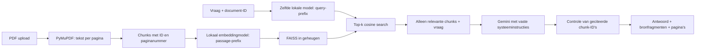

# Folio — PDF Knowledge Assistant

Een project waarmee je de stappen van Retrieval-Augmented Generation (RAG) zelf kunt volgen. Upload één PDF, stel een vraag en krijg een antwoord met uitklapbare bronfragmenten en links naar de gebruikte PDF-pagina's. De interface en foutmeldingen zijn Nederlandstalig.

React + TypeScript + Vite → FastAPI + PyMuPDF → eigen chunking → lokale sentence-transformers-embeddings → FAISS → Gemini API. Geen LangChain, LlamaIndex, database of agents. De bestaande endpoints, documentwissels en bronweergave zijn behouden.

## Snel starten

Vereist: Python **3.11+** en Node.js **22.12+** (bij voorkeur een ondersteunde LTS-versie), npm en een Gemini API-sleutel uit [Google AI Studio](https://aistudio.google.com/apikey). De code is lokaal getest met Python 3.13 en Node 22.12. Lokale embeddings gebruiken de CPU; een GPU of externe embedding-API is niet nodig. De eerste installatie downloadt ook PyTorch en de eerste modelstart downloadt de modelgewichten: houd rekening met enkele honderden MB download en extra schijfruimte/geheugen.

Voer de onderstaande commando's uit vanuit de hoofdmap van dit project, tenzij anders aangegeven.

### 1. Python-omgeving en configuratie

Windows PowerShell:

```powershell
python -m venv .venv
.\.venv\Scripts\python.exe -m pip install -e "./backend[dev]"
Copy-Item .env.example .env
```

macOS/Linux:

```bash
python3 -m venv .venv
source .venv/bin/activate
python -m pip install -e './backend[dev]'
cp .env.example .env
```

Vul `GEMINI_API_KEY` in de **`.env` in de hoofdmap** in. Laat `GEMINI_MODEL=gemini-3.5-flash-lite` en `EMBEDDING_MODEL=intfloat/multilingual-e5-small` staan, tenzij je bewust een ander ondersteund model kiest. De backend vindt dit bestand ongeacht je huidige werkmap. Zet de sleutel nooit in `frontend/` of in een `VITE_`-variabele: zulke variabelen worden zichtbaar in de browserbundle.

**Bestaande installatie bijwerken:** voer het bovenstaande `pip install -e "./backend[dev]"` opnieuw uit in de bestaande `.venv`. Bewerk een bestaande `.env` zelf en overschrijf deze niet met `Copy-Item`/`cp`: vervang de oude LLM-instellingen door `GEMINI_API_KEY`, `GEMINI_MODEL` en `GEMINI_TIMEOUT_SECONDS`, en vervang de oude embeddingmodelnaam door `intfloat/multilingual-e5-small`. De oude `OPENAI_API_KEY`, `LLM_MODEL` en `OPENAI_TIMEOUT_SECONDS` worden niet meer gebruikt. Herstart de backend en upload je PDF opnieuw. Er worden geen oude indexbestanden ingelezen; alle indices bestaan alleen in het geheugen en verdwijnen bij de herstart.

Activeren van de virtuele omgeving is op Windows optioneel:

```powershell
.\.venv\Scripts\Activate.ps1
```

Als PowerShell het activatiescript blokkeert, gebruik dan rechtstreeks `.\.venv\Scripts\python.exe` zoals hieronder. Een wijziging van het systeembeleid is niet nodig.

Je kunt de eenmalige modeldownload alvast uitvoeren, zonder Gemini-aanroep of API-sleutel:

```powershell
.\.venv\Scripts\python.exe backend/scripts/download_embeddings.py
```

Met geactiveerde omgeving werkt ook `python backend/scripts/download_embeddings.py`. Anders gebeurt de download bij de eerste PDF-upload. De gewichten staan standaard in `.model_cache/` in de hoofdmap; die map is genegeerd door Git. Het script controleert ook dat document- en vraagvectoren dezelfde dimensies hebben. Een download- of laadfout verschijnt in de API als `embedding_model_unavailable`. De eerste upload kan door downloaden en laden langer duren.

### 2. Backend starten (terminal 1)

Windows, vanuit de hoofdmap:

```powershell
.\.venv\Scripts\python.exe -m uvicorn app.main:app --app-dir backend --host 127.0.0.1 --port 8000 --reload
```

macOS/Linux met geactiveerde omgeving:

```bash
python -m uvicorn app.main:app --app-dir backend --host 127.0.0.1 --port 8000 --reload
```

Controle: [health](http://127.0.0.1:8000/api/health), [interactieve API-documentatie](http://127.0.0.1:8000/docs).

Zonder Gemini-sleutel werken de healthcheck en het lokaal verwerken van een PDF. Een vraag met relevante context geeft dan een begrijpelijke melding over `GEMINI_API_KEY`. Health meldt alleen of de sleutel is ingevuld, niet of Gemini bereikbaar is of het lokale model al is gedownload.

Gebruik één backendproces. Elke herstart, ook een automatische `--reload` na een codewijziging, wist het document. Upload de PDF daarna opnieuw. Start zonder `--reload` voor een stabiele demonstratie en gebruik geen meerdere workers.

### 3. Frontend starten (terminal 2)

```bash
cd frontend
npm ci
npm run dev
```

Open [http://127.0.0.1:5173](http://127.0.0.1:5173). Upload een PDF met selecteerbare tekst, wacht tot deze klaar is en stel een gerichte vraag. Enter verstuurt; Shift+Enter voegt een regel toe. Een nieuwe upload wist de chat.

De standaard backend-URL is `http://127.0.0.1:8000`. Alleen bij een andere URL: kopieer `frontend/.env.example` naar `frontend/.env`, pas `VITE_API_BASE_URL` aan en herstart Vite. Het devscript gebruikt `--strictPort`: een bezette poort 5173 levert een fout op in plaats van een onverwachte andere CORS-origin.

### 4. Voorbeeld voor je sollicitatiegesprek

Genereer vanuit de hoofdmap een fictief projectplan van drie pagina's:

```powershell
.\.venv\Scripts\python.exe backend/scripts/create_example.py
```

Of met een geactiveerde Python-omgeving:

```bash
python backend/scripts/create_example.py
```

Upload `examples/groenfiets.pdf`. Deze gegenereerde PDF is genegeerd door Git en kan altijd opnieuw worden gemaakt.

| Voorbeeldvraag | Verwachte informatie en bron |
| --- | --- |
| Wanneer begint GroenFiets en hoeveel fietsen zijn er? | 1 maart 2026, 24 fietsen; pagina 1 |
| Hoe is het budget verdeeld? | 12.000 fietsen, 4.000 onderhoud, 2.000 communicatie; pagina 2 |
| Wie is de projectleider? | Noor de Vries; pagina 2 |
| Wanneer wordt de pilot als succesvol beschouwd? | Minimaal 60% gebruikt twee dagen per week de fiets; pagina 3 |
| Wat was de omzet in 2025? | Onvoldoende informatie; geen verzonnen omzet of bronnen |

Dit zijn verwachtingen voor een handmatige controle, geen claim dat een live modelrun al is uitgevoerd. Modelantwoorden en retrieval kunnen variëren.

## Mappenstructuur

```text
.
├── .env.example
├── .gitignore
├── README.md
├── backend/
│   ├── pyproject.toml
│   ├── app/
│   │   ├── main.py          # App factory, CORS, routes en foutafhandeling
│   │   ├── config.py        # Gevalideerde environment variables
│   │   ├── schemas.py       # Pydantic API-contracten
│   │   ├── pdf.py           # Tekstextractie met fysieke paginanummers
│   │   ├── chunking.py      # Overlappende vensters per pagina
│   │   ├── embeddings.py    # Lokale CPU-embeddings, prefixes en modelcache
│   │   ├── retrieval.py     # Normalisatie en FAISS-index
│   │   ├── llm.py           # Provideronafhankelijk contract, prompt en antwoordmodel
│   │   ├── gemini.py        # Alle Gemini-SDK-aanroepen, timeouts en foutvertaling
│   │   ├── service.py       # RAG-stappen en documentlevenscyclus
│   │   └── errors.py        # Veilige applicatiefouten
│   ├── scripts/create_example.py
│   ├── scripts/download_embeddings.py
│   └── tests/
└── frontend/
    ├── .env.example
    ├── package.json
    ├── package-lock.json
    ├── vite.config.ts
    └── src/
        ├── App.tsx
        ├── api.ts           # Fetch, FormData en uniforme API-fouten
        ├── types.ts         # TypeScript API-data
        ├── validation.ts
        ├── useAssistant.ts  # Upload/chatstatus, annuleren en documentwissels
        ├── components/      # UploadPanel, ChatPanel, Composer, Sources, Icon
        └── *.test.*         # Interacties, validatie en API-contract
```

## Hoe RAG hier werkt

RAG zoekt eerst tekst die bij een vraag past en geeft alleen die tekst als context aan een taalmodel. Het model wordt hierbij niet opnieuw getraind. De kennis komt tijdens iedere aanvraag uit het document.



1. **Upload en extractie.** De frontend controleert extensie, MIME-type en grootte voor directe feedback. FastAPI controleert ze opnieuw, leest maximaal de limiet plus één byte en controleert de `%PDF-`-header. PyMuPDF opent vervolgens de inhoud: een bestandsnaam alleen is geen bewijs dat iets een PDF is. Wachtwoordbeveiligde, beschadigde of tekstloze bestanden krijgen een begrijpelijke fout. Lege pagina's worden overgeslagen, maar hun plaats in het PDF-bestand blijft meetellen.
2. **Chunking.** `chunk_pages` maakt vensters van standaard 1.200 **tekens**, met 200 tekens overlap. De stap is dus 1.000 tekens. Overlap houdt informatie rond een grens gedeeltelijk bijeen. Chunks gaan nooit over een paginagrens en bevatten `id`, `page` en `text`. Pagina 3 kan bijvoorbeeld `p3-c0` en `p3-c1` opleveren. Dit is bewust eenvoudige chunking: woorden of zinnen kunnen worden afgebroken en overlap stopt aan het pagina-einde.
3. **Embeddings.** `LocalEmbedder` gebruikt sentence-transformers op de CPU, met batches van 32 en genormaliseerde `float32`-vectoren. Er gaat geen documenttekst naar een embedding-API. Het model wordt pas bij de eerste embedding geladen, daarna eenmaal per backendproces hergebruikt. Documenten krijgen de prefix `passage: ` en vragen `query: `; beide gebruiken **dezelfde vastgelegde modelconfiguratie en modelinstantie**. Een lock voorkomt dubbele downloads/inferentie tijdens gelijktijdige verzoeken.
4. **Vector search.** FAISS `IndexFlatIP` bewaart de vectoren in het geheugen. Zowel document- als vraagvectoren worden naar lengte 1 genormaliseerd. Het inproduct is daardoor cosinussimilariteit. Dit is een exacte zoekopdracht zonder trainingsstap. Standaard gaan maximaal vier hits met score ≥ 0,2 door. Die drempel is een instelbare heuristiek, geen betrouwbare maat voor de kans dat het antwoord klopt. Ongeldige, lege, niet-eindige en nulvectoren worden afgewezen.
5. **Generatie.** Alleen de huidige vraag en de gevonden fragmenten gaan naar Gemini vanuit de backend. Het hele document en de eerdere chat worden niet meegestuurd. De vaste systeeminstructies vragen om uitsluitend contextfeiten te gebruiken en bij ontbrekende informatie niet te gokken. Geen hits betekent direct een vast antwoord over onvoldoende informatie, zonder LLM-aanroep.
6. **Bronnen.** Het LLM levert gestructureerde JSON met `answer`, `cited_chunk_ids` en `sufficient_context`. De backend accepteert alleen IDs uit de huidige retrieval, verwijdert dubbele IDs en haalt de paginanummers zelf uit de metadata. Er komen dus geen door het LLM verzonnen paginanummers in `sources`. Alleen geciteerde hits worden getoond. Bij onvoldoende context verschijnen geen bronnen. De browser gebruikt een tijdelijke `blob:`-URL van het originele bestand om `#page=N` te openen; het bestand wordt hiervoor niet nogmaals naar een server geüpload.

### Waarom deze provider en SDK?

De officiële **Google Gen AI Python-SDK `google-genai` 2.x** verzorgt uitsluitend de LLM-aanroepen. Google beveelt deze SDK aan; de oudere `google-generativeai`-bibliotheek wordt niet gebruikt. Alle providerinteractie staat in `gemini.py`, met `client.models.generate_content`, een afzonderlijke `system_instruction` en JSON Schema-output. Pydantic valideert het antwoord daarna opnieuw. Dit houdt de provider vervangbaar en laat de bestaande bronvalidatie intact. Zie [Google's SDK-keuze](https://ai.google.dev/gemini-api/docs/libraries) en [Python-SDK en gestructureerde antwoorden](https://googleapis.github.io/python-genai/).

### Modelkeuze, gratis tier en quota

Gecontroleerd in Google's officiële documentatie op **18 oktober 2026**:

| Tekstmodel | Vermeld in modelcatalogus | Invoer/uitvoer op Standard Free Tier volgens prijstabel |
| --- | --- | --- |
| `gemini-3.5-flash-lite` | Stabiel; standaard voor deze app | Gratis binnen beschikbare quota |
| `gemini-3.6-flash` | Beschikbaar | Gratis binnen beschikbare quota |
| `gemini-3.8-flash` | Beschikbaar | Gratis binnen beschikbare quota |

De compacte, stabiele [Gemini 3.5 Flash-Lite](https://ai.google.dev/gemini-api/docs/models/gemini-3.5-flash-lite) ondersteunt gestructureerde output en past bij korte vragen over opgehaalde tekst. De tabel komt uit [de modelcatalogus](https://ai.google.dev/gemini-api/docs/models) en [de Gemini-prijspagina](https://ai.google.dev/gemini-api/docs/pricing). Het is geen garantie dat jouw project ieder model kan gebruiken.

Gratis gebruik is onderhevig aan **quota, regionale beschikbaarheid en voorwaarden**, die kunnen wijzigen. Limieten kunnen gelden voor requests per minuut, invoertokens per minuut en requests per dag, en worden per Google-project toegepast. Bekijk de actuele waarden voor jouw account in [AI Studio](https://aistudio.google.com/usage?tab=rate-limit) en [Google's quota-uitleg](https://ai.google.dev/gemini-api/docs/rate-limits); deze README belooft geen vast aantal gratis requests. Bij quota-uitputting geeft de app 429 en gebruikt zij geen fallbackmodel of andere provider. Ook automatische retries staan uit. De code kan niet afdwingen dat jouw sleutel bij een gratis project hoort: een sleutel uit een betaald project kan kosten veroorzaken volgens de voorwaarden van dat project.

### Lokaal embeddingmodel en vervangbaarheid

`intfloat/multilingual-e5-small` ondersteunt meertalige retrieval, waaronder Nederlands, en levert 384-dimensionale vectoren. Volgens [de modelkaart](https://huggingface.co/intfloat/multilingual-e5-small) zijn de Engelse `query: `- en `passage: `-prefixes ook voor andere talen nodig. Teksten worden tot maximaal 512 tokens verwerkt; langere invoer wordt door het model afgekapt. De karaktergebaseerde chunking garandeert niet dat iedere configureerbare chunk onder die tokengrens valt. Kies bij lange/ongebruikelijke teksten kleinere chunks. De cosinusscores van E5 kunnen relatief hoog liggen, ook voor zwakke matches: kalibreer `MIN_SIMILARITY` op een evaluatieset en vertrouw niet op de oude drempel als kwaliteitsgarantie.

Het model wordt uit Hugging Face gedownload naar `EMBEDDING_CACHE_DIR`. Daarna kan het model uit die cache geladen worden. Stel `EMBEDDING_LOCAL_FILES_ONLY=true` in om latere modeldownloads/metadata-aanvragen uit te sluiten; Gemini heeft voor antwoorden nog steeds internet nodig. Een ontbrekende of onvolledige cache geeft dan een duidelijke fout. Er wordt geen remote modelcode uitgevoerd (`trust_remote_code=False`).

`Embedder` blijft een klein Python `Protocol`: `embed(texts, is_query=False)` levert een tweedimensionale `float32`-matrix. `is_query=True` selecteert alleen de vraagprefix; model en vectorruimte blijven gelijk. Kies bij een ander sentence-transformers-model passende `EMBEDDING_DOCUMENT_PREFIX` en `EMBEDDING_QUERY_PREFIX` volgens de bijbehorende modelkaart; sommige modellen vereisen lege prefixes. `AnswerGenerator` houdt het bestaande `generate(question, hits)`-contract en levert `GeneratedAnswer`. Via `create_app(..., embedder=..., generator=...)` kunnen tests fakes injecteren. Na iedere configuratiewissel: backend herstarten en PDF opnieuw uploaden. De modelconfiguratie staat per adapterinstantie vast; bestaande FAISS-bestanden worden nooit geladen, zodat oude vectoren niet met het nieuwe model worden gecombineerd.

### Documentwissels en gelijktijdigheid

Er is **één actief document per backendproces**, gedeeld door alle browservensters. Bij het starten van een upload wordt de oude index verwijderd, ook als de verwerking daarna mislukt. Een lock en een unieke uploadrevisie voorkomen dat een oudere upload later een nieuwer document overschrijft. De document-ID is dezelfde unieke revisie. Iedere vraag bevat die ID; een onbekende of vervangen ID leidt tot 404/409. Na de LLM-aanroep wordt de ID opnieuw gecontroleerd.

De frontend wist bij een geldige nieuwe bestandskeuze document en chat, annuleert het lopende fetchverzoek en negeert resultaten uit eerdere documentgeneraties. Annuleren in de browser stopt een reeds begonnen providerbewerking niet gegarandeerd. PDF-extractie, FAISS en synchrone SDK-aanroepen draaien in FastAPI's threadpool, zodat ze de eventloop niet blokkeren. Dit is geen systeem voor meerdere gelijktijdige gebruikers.

## API-contracten

Pydantic valideert requests en beschrijft responses in OpenAPI. TypeScript gebruikt dezelfde veldnamen in `src/types.ts`; deze types worden in deze versie handmatig bijgehouden. Aanpassingen aan het contract horen in beide bestanden en in de contracttests thuis.

| Methode en pad | Invoer | Succes |
| --- | --- | --- |
| `GET /api/health` | Geen | `200`: status, sleutel geconfigureerd, maximale uploadgrootte en vraaglengte |
| `POST /api/documents` | `multipart/form-data`, veld `file` | `201`: document-ID, bestandsnaam, totaal pagina's, pagina's met tekst, chunks |
| `POST /api/questions` | JSON met `document_id` en `question` | `200`: antwoord, bronnen, `insufficient_context` |

Uploadresponse:

```json
{
  "document_id": "e78160e1-35b9-4776-a2db-a52ce7cf2319",
  "filename": "groenfiets.pdf",
  "page_count": 3,
  "text_page_count": 3,
  "chunk_count": 3
}
```

Vraag:

```json
{
  "document_id": "e78160e1-35b9-4776-a2db-a52ce7cf2319",
  "question": "Wie is de projectleider?"
}
```

Voorbeeldantwoord (score en formulering variëren):

```json
{
  "answer": "De projectleider is Noor de Vries.",
  "sources": [{
    "chunk_id": "p2-c0",
    "page": 2,
    "text": "Budget en verantwoordelijkheden ... Projectleider is Noor de Vries. ...",
    "score": 0.68
  }],
  "insufficient_context": false
}
```

`text` bevat in de echte response het volledige geciteerde fragment; de weglatingstekens hierboven zijn alleen voor de leesbaarheid. Paginanummers zijn 1-gebaseerde fysieke PDF-pagina's, geen gedrukte hoofdstuknummers. `score` is cosinussimilariteit en wordt niet als betrouwbaarheidspercentage getoond.

Applicatie- en validatiefouten gebruiken hetzelfde formaat:

```json
{"error": {"code": "missing_api_key", "message": "Vul GEMINI_API_KEY in de .env van de backend in en herstart de backend."}}
```

Belangrijke statussen: 400 onleesbare/lege PDF, 404 geen actief document, 409 document vervangen, 413 grootte-/verwerkingslimiet, 415 verkeerd type, 422 ongeldig request, 429 Gemini-quotum bereikt, 502 providerfout of ongeldig antwoord, 503 ontbrekende/ongeldige sleutel of lokaal modelprobleem, 504 provider-timeout. Een niet te beantwoorden inhoudelijke vraag is geen API-fout en geeft 200 met `insufficient_context=true` en `sources=[]`.

### CORS

De browser ziet `http://127.0.0.1:5173` en `http://127.0.0.1:8000` als verschillende origins, omdat de poorten verschillen. FastAPI's `CORSMiddleware` staat standaard alleen de expliciete origins op 5173 toe, voor GET/POST en `Content-Type`. Een JSON-POST kan eerst een `OPTIONS`-preflight veroorzaken; de middleware beantwoordt die. Verander bij een andere frontendpoort ook `CORS_ORIGINS` en herstart de backend. `localhost` en `127.0.0.1` zijn verschillende hostnamen. CORS is browserbeleid, geen authenticatie of toegangsbeveiliging. Zie [FastAPI CORS](https://fastapi.tiangolo.com/tutorial/cors/).

## Configuratie

Environment variables overschrijven `.env`. Herstart de backend na wijzigingen. Ongeldige waarden, zoals overlap ≥ chunkgrootte, worden bij het starten afgewezen.

| Variabele | Standaard | Betekenis |
| --- | --- | --- |
| `GEMINI_API_KEY` | Leeg | Alleen backend; lokaal indexeren werkt zonder sleutel |
| `GEMINI_MODEL` | `gemini-3.5-flash-lite` | Gemini-model met gestructureerde output |
| `GEMINI_TIMEOUT_SECONDS` | `45` | Timeout per SDK-aanroep; één poging |
| `EMBEDDING_MODEL` | `intfloat/multilingual-e5-small` | Zelfde lokale model voor chunks en vragen |
| `EMBEDDING_CACHE_DIR` | `.model_cache` | Relatieve paden zijn relatief aan de projecthoofdmap |
| `EMBEDDING_LOCAL_FILES_ONLY` | `false` | Alleen de bestaande cache gebruiken, zonder modelnetwerkverzoeken |
| `EMBEDDING_DOCUMENT_PREFIX` | `"passage: "` | Documentprefix; behoud de afsluitende spatie |
| `EMBEDDING_QUERY_PREFIX` | `"query: "` | Vraagprefix; behoud de afsluitende spatie |
| `CHUNK_SIZE` | `1200` | Tekens per chunk; 50–4000 |
| `CHUNK_OVERLAP` | `200` | Tekens overlap; 0 ≤ overlap < grootte |
| `TOP_K` | `4` | Maximaal 1–12 relevante chunks |
| `MIN_SIMILARITY` | `0.2` | Minimale cosinussimilariteit; -1 tot 1 |
| `MAX_UPLOAD_MB` | `10` | Bestandsgrootte in MiB; 1–50 |
| `MAX_PAGES` | `200` | Maximaal aantal fysieke PDF-pagina's |
| `MAX_EXTRACTED_CHARS` | `1000000` | Limiet op geëxtraheerde tekst |
| `MAX_CHUNKS` | `2000` | Limiet vóór lokale embeddingberekening |
| `CORS_ORIGINS` | localhost/127.0.0.1 op 5173 | JSON-array van toegestane browserorigins |
| `VITE_API_BASE_URL` | `http://127.0.0.1:8000` | Alleen `frontend/.env`; publieke URL |

De maximale vraaglengte is 2.000 tekens en staat in `backend/app/schemas.py`. De frontend ontvangt deze grens en de uploadgrens via health. De sleutelaanwezigheidscheck in health is geen live controle van geldigheid, tegoed of modeltoegang.

## Testen en bouwen

Backend, vanuit de hoofdmap op Windows:

```powershell
.\.venv\Scripts\python.exe -m pytest backend/tests -q
```

Met geactiveerde omgeving, ook op macOS/Linux:

```bash
python -m pytest backend/tests -q
```

Frontend:

```bash
cd frontend
npm test
npm run build
npm run preview
```

`npm run build` doet ook de TypeScript-controle. `preview` serveert de productiebuild standaard op poort 4173. Voeg daarvoor `http://127.0.0.1:4173` toe aan `CORS_ORIGINS`, of gebruik `npm run preview -- --port 5173 --strictPort` terwijl de devserver uitstaat.

De backendtests maken kleine PDF's met PyMuPDF, gebruiken echte FAISS-retrieval en mocken Gemini-aanroepen en het laden/uitvoeren van het lokale model. Ze downloaden geen gewichten en hebben geen echte sleutel nodig. Ze controleren pagina-metadata, chunkgrenzen/overlap, prefixes, eenmalig modelladen, vaste embeddingconfiguratie, download-/API-fouten, gestructureerde LLM-invoer, veilige foutvertaling, bronvalidatie en documentwissels. Frontendtests gebruiken Vitest, Testing Library en jsdom voor de belangrijkste upload/chatinteracties, validatie, verzoekformaten en het afwijzen van late antwoorden. Een geslaagde gemockte test bewijst geen modelkwaliteit of weerstand tegen iedere promptinjectie.

Na de migratie: **81 backendtests en 16 frontendtests geslaagd**, TypeScript/Vite-productiebuild geslaagd en `pip check` zonder conflicten. De volledige backendintegratietest gebruikt de echte Gemini-SDK met een gemockte HTTP-transportlaag en controleert dat uploaden geen providerrequest doet en de bronpagina behouden blijft. Daarnaast zijn de echte modeldownload, lokale CPU-inferentie met 384 dimensies en een offline PDF/retrieval-controle geslaagd: de budgetvraag bij de voorbeeld-PDF vindt pagina 2, en een gemockt antwoord behoudt die bronpagina. Er is geen live Gemini-antwoord of visuele browsercontrole uitgevoerd. De geïnstalleerde Starlette-versie geeft bij de backendtests één deprecatiewaarschuwing over zijn `httpx`-testclient; de tests slagen. Hugging Face kan op Windows ook een waarschuwing geven over ontbrekende symlinkondersteuning; de cache werkt dan met extra schijfgebruik.

Handmatige integratiecontrole: start beide servers, upload de voorbeeld-PDF, stel een bronvraag en een vraag zonder antwoord in de PDF, open de bronpagina en upload daarna een andere PDF. Controleer dat de chat leeg wordt en antwoorden uit het eerste document niet terugkomen. Controleer ook een tekstloos bestand en een ontbrekende of ongeldige sleutel.

## Grenzen en omgang met onbetrouwbare inhoud

- **PDF-instructies zijn data.** Fragmenten staan als JSON-data in een userbericht; de vaste systeemprompt staat apart in `system_instruction`. De prompt verbiedt het opvolgen van documentinstructies en het overschrijven van systeemregels. Er zijn geen tools of andere uitvoerrechten voor het LLM. De API-sleutel staat nooit in de prompt. Dit beperkt promptinjectie, maar biedt geen waterdichte garantie. Bronvalidatie bewijst dat een bron bestaat, niet dat elk antwoordfeit er logisch uit volgt.
- **Externe verwerking.** Embeddings worden lokaal berekend. Alleen de vraag en de opgehaalde fragmenten gaan naar Google Gemini voor het antwoord. De Free Tier kan afwijkende datagebruiksvoorwaarden hebben; volgens [de prijspagina](https://ai.google.dev/gemini-api/docs/pricing) kan inhoud van gratis diensten worden gebruikt voor productverbetering. Controleer de actuele voorwaarden voor jouw regio/project. De modeldownload haalt gewichten van Hugging Face op en uploadt geen PDF-tekst. De applicatie schrijft zelf geen PDF's of indices permanent weg, maar bewaart de modelgewichten op schijf. FastAPI/Starlette kan multipart-uploads tijdelijk bufferen en sluit ze na verwerking. De browser bewaart de oorspronkelijke PDF tijdelijk voor bronlinks. Lettertypen worden, indien bereikbaar, geladen via Google Fonts; systeemlettertypen zijn de fallback.
- **Eén lokale gebruiker.** Geen database, persistentie, sessies of authenticatie. Alle tabbladen delen dezelfde documentplek. Een herstart wist de index; een browserrefresh wist de lokale chat. De backend bindt in de startinstructies aan loopback. Geen publieke hosting in deze versie.
- **PDF-kwaliteit.** Geen OCR, wachtwoordontgrendeling of interpretatie van afbeeldingen. Meerdere kolommen, tabellen en afwijkende leesvolgorde kunnen fout worden geëxtraheerd. Header- en parsercontrole beperken verkeerde uploads, maar zijn geen sandbox voor kwaadaardige PDF-bestanden. De bestandsgrootte wordt in de route gecontroleerd nadat het multipartverzoek is geparset; dit is geen harde limiet vóór ontvangst of bescherming tegen resource-uitputting op een publieke server.
- **Retrieval en context.** Overlap is op tekens en stopt aan paginagrenzen. Het lokale model verwerkt maximaal 512 tokens per invoer; zeer lange chunks of vragen kunnen dus worden afgekapt. De drempel is niet gekalibreerd. Een relevante passage kan buiten top-k vallen; brede vragen over het hele document kunnen daarom onvolledig worden beantwoord. Voornaamwoorden als “en wat kost dat?” worden niet met chatgeschiedenis herschreven: stel zelfstandige vragen.
- **Antwoordkwaliteit.** Structured Outputs garandeert het afgesproken formaat bij een geslaagd modelantwoord, geen feitelijke juistheid. Een model kan weigeren of output kan worden afgebroken; dit wordt een begrijpelijke API-fout. Het tonen van een bron betekent niet dat hallucinaties onmogelijk zijn.
- **Gebruikskosten en latentie.** Iedere upload berekent lokaal embeddings; iedere vraag maakt een lokale vraagembedding en meestal één Gemini-aanroep. Gewichten blijven gecachet, maar tekstembeddings en antwoorden niet. De eerste modelstart duurt langer; herstarts laden het model opnieuw in het geheugen. Gratis Gemini-gebruik is niet onbeperkt. De timeout geldt per Gemini-request, niet voor het downloaden of lokaal verwerken. Een browserannulering stopt een lopende Gemini-aanroep niet gegarandeerd. Geen streaming, automatische retries of betaalde fallbackprovider.

## Uitleg voor een technisch gesprek

- **Waarom geen RAG-framework?** Je kunt elke stap, input en output aanwijzen. `service.py` laat de volledige keten zien; adapters beperken de afhankelijkheid van één provider.
- **Waarom overlappende chunks?** Een antwoord kan rond een knip liggen. Overlap verhoogt de kans dat de relevante passage samen blijft, ten koste van meer embeddings en herhaling in context.
- **Waarom FAISS Flat?** Voor één kleine PDF is exacte zoekactie eenvoudig en goed te testen. Een approximate index voegt pas bij veel grotere aantallen nuttige complexiteit toe.
- **Waarom twee representaties?** FAISS bevat vectoren voor het zoeken; de geordende chunklijst bevat tekst en metadata voor prompts en bronverwijzingen. De gevonden index koppelt die twee.
- **Waarom een document-ID?** De client moet aantonen op welke documentversie de vraag betrekking heeft. Daarmee kun je een oud tabblad of een laat antwoord herkennen.
- **Wat voorkomt verzonnen antwoorden?** Contextbeperking, een expliciete abstentie-instructie, een retrievaldrempel en controle op geciteerde IDs helpen. Een broncontrole vervangt geen inhoudelijke evaluatie.
- **Hoe evalueer je dit?** Maak een vaste set vraag/antwoord/bronpagina-triples. Meet apart retrieval recall@k, feitelijke onderbouwing, juistheid van bronverwijzingen, correct afzien van antwoord, kosten en latentie. Alleen een prettig geformuleerd antwoord is onvoldoende bewijs.

Mogelijke vervolgstappen: een kleine evaluatieset, token-/zinsbewuste chunking, hybride zoekactie en reranking, OCR, chatvraagherschrijving en pas bij een concrete behoefte documentopslag en gebruikerssessies. Houd die uitbreidingen buiten deze eerste versie.
