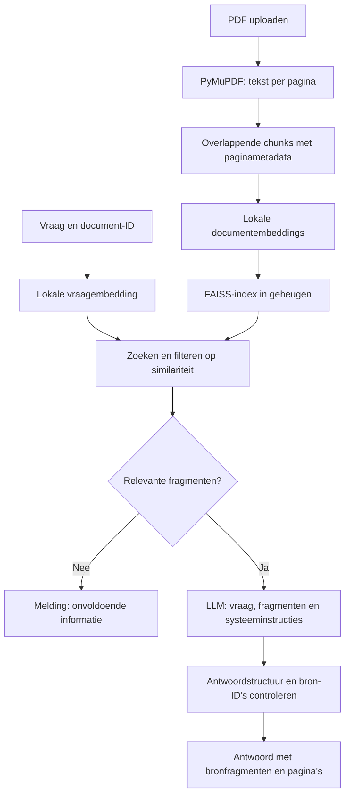

# Folio - PDF Knowledge Assistant

Folio is een webapplicatie voor het stellen van vragen over een PDF. Een gebruiker uploadt een document en ontvangt antwoorden met uitklapbare bronfragmenten en verwijzingen naar de gebruikte pagina's.

De applicatie gebruikt Retrieval-Augmented Generation (RAG): relevante tekst wordt eerst uit het document opgehaald en daarna als context aan een taalmodel (LLM) doorgegeven. Embeddings en zoekopdrachten worden lokaal uitgevoerd. Alleen de vraag en de gevonden fragmenten worden voor het antwoord naar een externe LLM-provider gestuurd.

## Functionaliteiten

- Eén PDF uploaden via bestandskeuze of slepen.
- Validatie van bestandstype, bestandsgrootte en leesbare PDF-inhoud.
- Tekstextractie per pagina, met behoud van de oorspronkelijke paginanummers.
- Vragen stellen via een chatinterface met voorbeeldvragen en laadstatussen.
- Antwoorden bekijken met geciteerde tekstfragmenten en links naar de bronpagina's.
- Een melding bij onvoldoende context, ontbrekende configuratie of verwerkingsfouten.
- Een document vervangen, waarbij de vorige index en de chat worden gewist.

De interface en foutmeldingen zijn Nederlandstalig. Het taalmodel krijgt de instructie om in de taal van de vraag te antwoorden.

## Installatie

### Vereisten

- Python 3.11 of hoger.
- Node.js 22.12 of hoger en npm.
- Een API-sleutel voor de huidige LLM-adapter.
- Internet voor de eerste download van het embeddingmodel en voor LLM-aanroepen.

De huidige LLM-adapter gebruikt de Gemini API via de officiële Python-SDK `google-genai`. De sleutel kan worden aangemaakt in [Google AI Studio](https://aistudio.google.com/apikey). De API-sleutel blijft uitsluitend in de backend.

Lokale embeddings draaien op de CPU; een GPU is niet vereist. De installatie bevat ook PyTorch. Het embeddingmodel wordt bij het eerste gebruik gedownload en neemt extra schijfruimte en werkgeheugen in beslag.

Alle onderstaande commando's worden vanuit de hoofdmap uitgevoerd, tenzij anders vermeld.

### Backend installeren en configureren

Windows PowerShell:

```powershell
python -m venv .venv
.\.venv\Scripts\python.exe -m pip install -e "./backend[dev]"
Copy-Item .env.example .env
```

macOS/Linux:

```bash
python3 -m venv .venv
source .venv/bin/activate
python -m pip install -e './backend[dev]'
cp .env.example .env
```

De kopieerstap is alleen nodig wanneer `.env` nog niet bestaat. Een bestaande configuratie kan behouden en handmatig aangepast worden.

In `.env` in de hoofdmap wordt `GEMINI_API_KEY` ingevuld. De modelinstellingen staan in `.env.example`; de backend leest dit bestand niet rechtstreeks, maar gebruikt `.env` en environment variables. Bestaande environment variables hebben voorrang op `.env`.

Het standaard LLM-model in de code is `gemini-3.5-flash-lite`. `GEMINI_MODEL` kan worden aangepast naar een model dat beschikbaar is voor het betreffende providerproject en gestructureerde JSON-output ondersteunt. De ingestelde modelnaam is geen garantie op beschikbaarheid of gratis toegang.

De backend vindt de `.env` in de hoofdmap onafhankelijk van de werkmap. Na wijzigingen aan de configuratie moet de backend opnieuw worden gestart.

### Backend starten

Windows PowerShell, in de eerste terminal:

```powershell
.\.venv\Scripts\python.exe -m uvicorn app.main:app --app-dir backend --host 127.0.0.1 --port 8000 --reload
```

macOS/Linux, met geactiveerde virtuele omgeving:

```bash
python -m uvicorn app.main:app --app-dir backend --host 127.0.0.1 --port 8000 --reload
```

- Healthcheck: <http://127.0.0.1:8000/api/health>
- Interactieve API-documentatie: <http://127.0.0.1:8000/docs>

Stoppen kan met `Ctrl+C`; opnieuw starten kan met hetzelfde commando. De optie `--reload` herstart de backend bij codewijzigingen. Iedere herstart wist het actieve document en de index: daarna is een nieuwe upload nodig.

De applicatie gebruikt één backendproces. Meerdere workers worden niet ondersteund, omdat ieder proces een eigen documentindex heeft.

### Frontend starten

In een tweede terminal:

```bash
cd frontend
npm ci
npm run dev
```

De applicatie is beschikbaar op <http://127.0.0.1:5173>. Het devscript vereist dat poort 5173 vrij is.

De frontend gebruikt standaard `http://127.0.0.1:8000` als backend-URL. Voor een ander adres kan `frontend/.env.example` worden gekopieerd naar `frontend/.env` en `VITE_API_BASE_URL` worden aangepast. Vervolgens moet Vite opnieuw worden gestart of de frontend opnieuw worden gebouwd.

`VITE_`-variabelen zijn openbaar in de browserbundle. Een LLM-API-sleutel hoort daarom nooit in de frontendconfiguratie.

## Gebruik

1. Open de webapplicatie en kies een PDF met selecteerbare tekst.
2. Wacht tot de verwerking klaar is. Het documentpaneel toont de bestandsnaam, het aantal pagina's en het aantal tekstfragmenten.
3. Stel een gerichte vraag of selecteer een voorbeeldvraag. `Enter` verstuurt de vraag; `Shift+Enter` voegt een nieuwe regel toe.
4. Open de bronfragmenten onder het antwoord om de onderbouwing te lezen. De paginalink opent het oorspronkelijke document bij de betreffende PDF-pagina, voor zover de PDF-viewer dat ondersteunt.
5. Upload een andere PDF om het document en de chat te vervangen.

Een vraag mag maximaal 2.000 tekens bevatten. De chat toont eerdere berichten, maar stuurt die niet mee naar de LLM. Iedere vraag moet daarom zelfstandig te begrijpen zijn.

Zonder ingestelde API-sleutel werken de healthcheck en lokale documentverwerking. Antwoorden waarvoor een LLM-aanroep nodig is geven dan een configuratiemelding. `configured` in de healthcheck controleert alleen of een niet-lege sleutel is ingesteld; het test geen toegang tot de provider of beschikbaarheid van het embeddingmodel.

### Voorbeelddocument

Het volgende script maakt een fictief projectplan van drie pagina's:

```powershell
.\.venv\Scripts\python.exe backend/scripts/create_example.py
```

Met een geactiveerde Python-omgeving kan ook `python backend/scripts/create_example.py` worden gebruikt. Het resultaat staat in `examples/groenfiets.pdf` en wordt door Git genegeerd.

| Voorbeeldvraag | Informatie in het document |
| --- | --- |
| Wanneer begint GroenFiets en hoeveel fietsen zijn beschikbaar? | 1 maart 2026 en 24 fietsen; pagina 1 |
| Hoe is het budget verdeeld? | 12.000 euro voor fietsen, 4.000 euro voor onderhoud en 2.000 euro voor communicatie; pagina 2 |
| Wie is de projectleider? | Noor de Vries; pagina 2 |
| Wanneer is de pilot succesvol? | Als minimaal 60% twee dagen per week de fiets gebruikt in plaats van de auto; pagina 3 |
| Wat was de omzet in 2025? | Deze informatie ontbreekt; een melding over onvoldoende informatie is het verwachte gedrag |

Dit zijn voorbeelden voor handmatige controle. De gevonden fragmenten en de formulering van modelantwoorden kunnen variëren.

## Architectuur

| Onderdeel | Technologie | Verantwoordelijkheid |
| --- | --- | --- |
| Frontend | React, TypeScript en Vite | Upload, chat, laadstatussen en bronweergave |
| HTTP API | Python, FastAPI en Pydantic | Validatie, API-contracten en foutafhandeling |
| PDF-verwerking | PyMuPDF | Tekstextractie per fysieke pagina |
| Chunking | Eigen Python-functie | Overlappende tekstvensters met paginametadata |
| Embeddings | sentence-transformers | Lokale vectoren voor documenttekst en vragen |
| Retrieval | FAISS `IndexFlatIP` | Exact zoeken op cosinussimilariteit |
| Antwoordgeneratie | LLM-adapter, momenteel `google-genai` | Antwoord op basis van opgehaalde context |
| Tests | pytest, Vitest en Testing Library | Backendlogica, API en frontendinteracties |

De RAG-stappen worden expliciet in de backend uitgevoerd, zonder LangChain of LlamaIndex. Er is geen database, authenticatie of permanente documentopslag.

```text
backend/
  app/
    main.py          FastAPI-app, CORS, routes en foutafhandeling
    config.py        Instellingen uit environment variables en .env
    schemas.py       Pydantic-modellen voor requests en responses
    pdf.py           PDF-validatie en tekst per pagina
    chunking.py      Tekstfragmenten met ID en paginanummer
    embeddings.py    Embedder-interface, lokaal model en modelcache
    retrieval.py     Vectorvalidatie, normalisatie en FAISS
    llm.py           AnswerGenerator-interface, systeemprompt en antwoordmodel
    gemini.py        Huidige LLM-adapter, SDK-aanroepen en foutvertaling
    service.py       RAG-pipeline en documentlevenscyclus
    errors.py        Applicatiefouten
  scripts/
    create_example.py
    download_embeddings.py
  tests/
  pyproject.toml
frontend/
  src/
    App.tsx          Samenstelling van de interface
    api.ts           HTTP-verzoeken en API-fouten
    types.ts         TypeScript API-types
    validation.ts    Bestandsvalidatie in de browser
    useAssistant.ts  Document-, chat- en verzoekstatus
    components/      UploadPanel, ChatPanel, Composer, Sources en Icon
  .env.example
  package.json
.env.example
README.md
```

## RAG-pipeline

RAG combineert zoeken met tekstgeneratie. Een embeddingmodel zet tekst om in vectoren waarmee inhoudelijk vergelijkbare passages gevonden kunnen worden. Een LLM genereert vervolgens een antwoord met die passages als context. Het document wordt hierbij niet gebruikt om een model opnieuw te trainen.



### 1. Extractie en chunking

De browser controleert het bestand voor directe feedback. De backend valideert opnieuw de extensie, het MIME-type, de grootte en de PDF-header. PyMuPDF leest daarna de tekst per pagina. Beschadigde, wachtwoordbeveiligde en tekstloze PDF's worden afgewezen.

Lege pagina's worden overgeslagen zonder de overige pagina's opnieuw te nummeren. Paginanummers verwijzen naar de fysieke positie in het PDF-bestand, beginnend bij 1, en kunnen afwijken van afgedrukte paginanummers.

De functie `chunk_pages` maakt standaard vensters van 1.200 tekens met 200 tekens overlap. Een volgend venster begint dus 1.000 tekens verder. Overlap behoudt een deel van de tekst rond een knip. Een chunk blijft altijd binnen één pagina en bevat `id`, `page` en `text`, bijvoorbeeld `p3-c0` voor het eerste fragment van pagina 3.

### 2. Lokale embeddings

Het geconfigureerde standaardmodel is `intfloat/multilingual-e5-small`, een meertalig model voor onder meer Nederlandse tekst. Voor dit model worden documentfragmenten voorafgegaan door `passage: ` en vragen door `query: `.

`LocalEmbedder` gebruikt sentence-transformers op de CPU, verwerkt batches van 32 en retourneert genormaliseerde `float32`-vectoren. Het model wordt pas bij de eerste embedding geladen en daarna binnen hetzelfde backendproces hergebruikt. Documenten en vragen gebruiken dezelfde vastgelegde modelconfiguratie en modelinstantie.

De eerste uitvoering downloadt modelbestanden van Hugging Face naar `.model_cache/`. Dit kan vooraf worden uitgevoerd, zonder LLM-aanroep:

```powershell
.\.venv\Scripts\python.exe backend/scripts/download_embeddings.py
```

Met een geactiveerde Python-omgeving werkt ook `python backend/scripts/download_embeddings.py`. Het script controleert of document- en vraagvectoren dezelfde vorm hebben. Met `EMBEDDING_LOCAL_FILES_ONLY=true` wordt uitsluitend de bestaande cache gebruikt; deze moet dan al volledig beschikbaar zijn. Documenttekst wordt niet naar een externe embedding-API gestuurd.

### 3. FAISS-retrieval

FAISS bewaart de documentvectoren in een `IndexFlatIP`. Zowel index- als vraagvectoren worden naar lengte 1 genormaliseerd, waardoor hun inproduct overeenkomt met cosinussimilariteit. De index zoekt exact en heeft geen trainingsstap nodig.

Standaard worden maximaal vier fragmenten met een score van ten minste `0.2` geselecteerd. Deze drempel is een configureerbare heuristiek; een score is geen betrouwbaarheidspercentage. De chunklijst bewaart de tekst en metadata waarmee de gevonden vectorposities worden terugvertaald naar bronnen.

### 4. LLM en antwoordvalidatie

Alleen de huidige vraag en opgehaalde fragmenten gaan vanuit de backend naar de LLM. Het volledige document en eerdere chatberichten worden niet meegestuurd. Zonder zoekresultaten retourneert de backend direct een vast antwoord over onvoldoende informatie, zonder LLM-aanroep.

De huidige adapter gebruikt de officiële `google-genai`-SDK, een afzonderlijke systeeminstructie en gestructureerde JSON-output met `answer`, `cited_chunk_ids` en `sufficient_context`. Pydantic valideert de antwoordstructuur.

De backend accepteert alleen geciteerde chunk-ID's uit de huidige zoekresultaten. Dubbele ID's worden verwijderd en de bronpagina's worden uit de opgeslagen metadata gehaald. Een antwoord zonder geldige bronnen wordt afgewezen. Als het model onvoldoende context rapporteert, toont de applicatie een vaste melding zonder bronnen.

Een geldige bron-ID bewijst dat het fragment is opgehaald, maar niet dat iedere bewering in het antwoord door dat fragment wordt onderbouwd. Bronfragmenten blijven daarom beschikbaar voor inhoudelijke controle.

### Provider vervangen

`AnswerGenerator` in `llm.py` beschrijft het contract `generate(question, hits) -> GeneratedAnswer`. Een andere provider kan worden aangesloten met een eigen adapter die dit contract implementeert en wordt ingesteld in `create_app` in `main.py`. Tests kunnen een vervangende implementatie direct injecteren.

Alleen `GEMINI_MODEL` wijzigen schakelt niet naar een andere provider: de huidige adapter en configuratienamen zijn specifiek voor de huidige SDK. De interface en foutmeldingen van de app gebruiken providerneutrale termen.

## Configuratie

| Variabele | Standaard | Betekenis |
| --- | --- | --- |
| `GEMINI_API_KEY` | Leeg | API-sleutel voor de huidige LLM-adapter; uitsluitend backend |
| `GEMINI_MODEL` | `gemini-3.5-flash-lite` | Modelnaam voor de huidige LLM-adapter |
| `GEMINI_TIMEOUT_SECONDS` | `45` | Timeout per LLM-aanroep; maximaal 180 seconden |
| `EMBEDDING_MODEL` | `intfloat/multilingual-e5-small` | Lokaal sentence-transformers-model |
| `EMBEDDING_CACHE_DIR` | `.model_cache` in de hoofdmap | Locatie van modelbestanden; relatieve paden worden vanaf de hoofdmap opgelost |
| `EMBEDDING_LOCAL_FILES_ONLY` | `false` | Alleen reeds gedownloade modelbestanden gebruiken |
| `EMBEDDING_DOCUMENT_PREFIX` | `"passage: "` | Prefix voor documentfragmenten, inclusief afsluitende spatie |
| `EMBEDDING_QUERY_PREFIX` | `"query: "` | Prefix voor vragen, inclusief afsluitende spatie |
| `CHUNK_SIZE` | `1200` | Maximale venstergrootte in tekens; toegestaan van 50 tot 4.000 |
| `CHUNK_OVERLAP` | `200` | Overlap in tekens; minimaal 0 en kleiner dan `CHUNK_SIZE` |
| `TOP_K` | `4` | Maximaal aantal opgehaalde fragmenten; toegestaan van 1 tot 12 |
| `MIN_SIMILARITY` | `0.2` | Minimale cosinussimilariteit; toegestaan van -1 tot 1 |
| `MAX_UPLOAD_MB` | `10` | Bestandslimiet; berekend als de ingestelde waarde × 1.024 × 1.024 bytes, maximaal 50 |
| `MAX_PAGES` | `200` | Maximaal aantal fysieke PDF-pagina's |
| `MAX_EXTRACTED_CHARS` | `1000000` | Maximale hoeveelheid geëxtraheerde tekst |
| `MAX_CHUNKS` | `2000` | Maximaal aantal chunks vóór het berekenen van embeddings |
| `CORS_ORIGINS` | `["http://localhost:5173","http://127.0.0.1:5173"]` | Toegestane browserorigins als JSON-array |
| `VITE_API_BASE_URL` | `http://127.0.0.1:8000` | Publieke backend-URL, uitsluitend in `frontend/.env` |

Bij een ander embeddingmodel moeten ook de prefixes op de vereisten van dat model worden afgestemd. Na model- of chunkingwijzigingen moet de backend opnieuw worden gestart en het document opnieuw worden geüpload. Er worden geen oude FAISS-bestanden ingelezen, zodat vectoren uit verschillende modelconfiguraties niet worden gecombineerd.

Gratis API-gebruik is afhankelijk van het providerproject, quota en voorwaarden. Modeltoegang, limieten en tarieven kunnen wijzigen. De applicatie controleert niet of een sleutel aan een gratis of betaald project is gekoppeld. De actuele instellingen staan in [AI Studio](https://aistudio.google.com/) en de providerdocumentatie over [modellen](https://ai.google.dev/gemini-api/docs/models), [tarieven](https://ai.google.dev/gemini-api/docs/pricing) en [quota](https://ai.google.dev/gemini-api/docs/rate-limits). Bij een fout of bereikt quotum zijn er geen automatische retries en geen fallbackprovider.

## API en CORS

FastAPI beschrijft de API in OpenAPI. Pydantic valideert backendrequests en responses; de frontend gebruikt overeenkomstige TypeScript-types in `frontend/src/types.ts`. Deze types worden handmatig bijgehouden.

| Methode | Endpoint | Invoer | Succesresponse |
| --- | --- | --- | --- |
| `GET` | `/api/health` | Geen | `200`: `status`, `configured`, `max_upload_mb`, `max_question_chars` |
| `POST` | `/api/documents` | `multipart/form-data` met veld `file` | `201`: `document_id`, `filename`, `page_count`, `text_page_count`, `chunk_count` |
| `POST` | `/api/questions` | JSON met `document_id` en `question` | `200`: `answer`, `sources`, `insufficient_context` |

Voorbeeld van een vraag, met de document-ID uit de uploadresponse:

```json
{
  "document_id": "e78160e1-35b9-4776-a2db-a52ce7cf2319",
  "question": "Wie is de projectleider?"
}
```

Iedere bron in `sources` bevat `chunk_id`, `page`, `text` en `score`. `text` bevat het volledige geciteerde fragment. Bij onvoldoende informatie is `insufficient_context` gelijk aan `true` en is `sources` leeg; de response blijft dan `200`.

Fouten gebruiken een vast formaat:

```json
{
  "error": {
    "code": "provider_timeout",
    "message": "De LLM reageert te langzaam. Probeer opnieuw."
  }
}
```

De frontend en backend draaien lokaal op verschillende origins. CORS staat browserverzoeken alleen toe voor de geconfigureerde combinatie van schema, hostnaam en poort. Bij een ander frontendadres moet `CORS_ORIGINS` worden aangepast en de backend opnieuw worden gestart. CORS vervangt geen authenticatie of toegangscontrole.

### Veelvoorkomende fouten

| Status of melding | Betekenis en oplossing |
| --- | --- |
| Backend niet bereikbaar | Controleer of FastAPI draait op de ingestelde API-URL en of de browserorigin is toegestaan |
| `400` | Lege, beschadigde, beveiligde of tekstloze PDF; gebruik een leesbaar document, eventueel na externe OCR |
| `404` of `409` | Het document ontbreekt of is vervangen; upload de PDF opnieuw |
| `413` | Een limiet voor bestandsgrootte, pagina's, tekst of chunks is overschreden |
| `415` | Het bestandstype wordt niet geaccepteerd |
| `422` | Ongeldige invoer, bijvoorbeeld een lege of te lange vraag of ongeldige document-ID |
| `429` | Gebruikslimiet van de LLM-provider bereikt; wacht of controleer het providerproject |
| `502` | Providerfout, onbereikbare provider, ongeldige modeloutput of ongeldige embeddings/bronnen |
| `503` | Ontbrekende/ongeldige API-sleutel, ontbrekende toegang of een lokaal embeddingprobleem |
| `504` | De LLM-aanroep heeft de timeout bereikt of de provider meldt een timeout |

## Documentlevenscyclus en gegevensverwerking

Er is één actief document per backendproces, gedeeld door alle browservensters. Zodra een upload de backend bereikt, wordt de oude index ongeldig, ook wanneer die upload daarna mislukt. Een unieke documentrevisie en locks voorkomen dat een oudere upload alsnog een nieuwer document overschrijft. Vragen bevatten een document-ID; na de LLM-aanroep controleert de backend opnieuw of het document nog actief is.

De frontend wist bij een geldige nieuwe bestandskeuze de chat en negeert late antwoorden van het vorige document. Annuleren van een browserverzoek stopt een al gestarte LLM-aanroep niet gegarandeerd. PDF-verwerking en synchrone modelaanroepen draaien buiten de ASGI-eventloop in de threadpool.

PDF-tekst en vragen worden als onbetrouwbare data meegestuurd, gescheiden van de systeeminstructies. Het model wordt geïnstrueerd om instructies in documenten niet uit te voeren en alleen contextfeiten te gebruiken. Dit beperkt het risico op promptinjectie, maar biedt geen volledige garantie tegen ongewenste modelantwoorden.

De applicatie bewaart documenttekst en de FAISS-index in het geheugen. Modelgewichten blijven in de lokale cache staan. FastAPI/Starlette kan uploads tijdens verwerking tijdelijk bufferen. De browser houdt het oorspronkelijke bestand tijdelijk beschikbaar via een `blob:`-URL voor bronlinks. Alleen de vraag en opgehaalde fragmenten gaan naar de ingestelde LLM-provider; daarvoor gelden diens gegevensverwerkingsvoorwaarden. Lettertypen worden via Google Fonts geladen als die dienst bereikbaar is.

`.env`, modelcache, gegenereerde PDF's, buildoutput en indexbestanden worden door `.gitignore` uitgesloten.

## Tests en build

Backendtests, vanuit de hoofdmap op Windows:

```powershell
.\.venv\Scripts\python.exe -m pytest backend/tests -q
```

macOS/Linux met geactiveerde omgeving:

```bash
python -m pytest backend/tests -q
```

Frontendtests en productiebuild, vanuit `frontend/`:

```bash
npm test
npm run build
```

| Testbestand | Onderwerp |
| --- | --- |
| `backend/tests/test_pdf_chunking.py` | PDF-extractie, foutgevallen, chunkgrenzen, overlap en paginanummers |
| `backend/tests/test_embeddings.py` | Lokale modeladapter, prefixes, hergebruik van het model en laad-/inferentiefouten |
| `backend/tests/test_retrieval.py` | Echte FAISS-retrieval, normalisatie, filters en ongeldige vectoren |
| `backend/tests/test_config.py` | Environment variables en configuratievalidatie |
| `backend/tests/test_providers.py` | LLM-invoer, gestructureerde antwoorden en veilige foutafhandeling |
| `backend/tests/test_api.py` | Upload/vraag-endpoints, bronnen, CORS en documentwissels |
| `backend/tests/test_integration.py` | Volledige API-pipeline met echte SDK en FAISS, gemockt HTTP-verkeer en gemockte modelinferentie |
| `frontend/src/App.test.tsx` | Upload/chatinteracties, fouten, bronnen en late antwoorden |
| `frontend/src/api.test.ts` | Verzoekformaten en API-foutafhandeling |
| `frontend/src/validation.test.ts` | Bestandsvalidatie |

Automatische tests vereisen geen echte API-sleutel, betaalde requests of download van modelgewichten. Ze controleren de applicatielogica met gemockte externe interacties. Een geslaagde testsuite bevestigt geen live providerbeschikbaarheid, feitelijke modelkwaliteit of volledige weerstand tegen promptinjectie. De frontendbuild voert TypeScript-controle uit en schrijft de productieoutput naar `frontend/dist/`.

## Beperkingen

- Eén document per backendproces; geen afzonderlijke gebruikerssessies, authenticatie of permanente document- en chatopslag.
- Geen ingebouwde OCR. Scans zonder tekstlaag worden niet inhoudelijk verwerkt. Tabellen, kolommen en complexe opmaak kunnen bij extractie structuur verliezen.
- Chunking gebruikt tekens en houdt geen rekening met zins- of tokengrenzen. Lange invoer kan door het embeddingmodel worden afgekapt; overlap loopt niet door over paginagrenzen.
- Retrieval kan relevante informatie missen of zwakke matches doorlaten. `TOP_K` en `MIN_SIMILARITY` zijn geen garantie op een juist antwoord.
- Bron-ID's en metadata worden gecontroleerd, maar de inhoudelijke juistheid van het antwoord wordt niet automatisch bewezen. Er is nog geen vaste evaluatieset voor retrieval- en antwoordkwaliteit.
- Eerdere chatberichten worden niet als context gebruikt. Vervolgvragen met verwijzingen zoals 'en wanneer gebeurde dat?' kunnen daardoor onvoldoende context hebben.
- Geen streaming, automatische retries of fallbackprovider. De timeout geldt voor de LLM-aanroep, niet voor lokale documentverwerking of modeldownloads.
- De applicatie is ingericht voor lokaal gebruik met één backendproces; productiehosting en gebruik door meerdere gebruikers vereisen aanvullende inrichting.

Mogelijke uitbreidingen zijn OCR, chunking op zinnen of tokens, hybride zoekopdrachten, reranking, een vaste evaluatieset, verwerking van chatcontext en afzonderlijke documentopslag per gebruiker.
